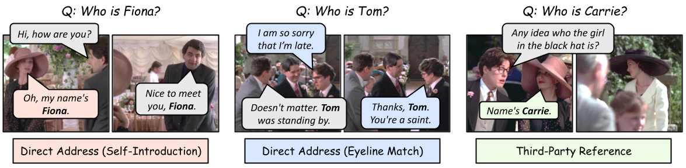

# As the Story Unfolds: Watching a Film and Identifying Characters as a Human Does (StreamCast)

[[📖 Paper](https://arxiv.org/abs/2610.37579)] [[🤗 Model](https://drive.google.com/drive/folders/1thjUjid3B5QvbHUhErFJBVGtWukBpnVK?usp=sharing)] [[🤗 Dataset](https://huggingface.co/datasets/g2zr004/MovieCharacterNaming/)] [[🎬 Project Page](https://www.robots.ox.ac.uk/~vgg/research/StreamCast/)]

Zhongrui Gui<sup>1</sup>, Junyu Xie<sup>1</sup>, Tengda Han<sup>1</sup>, Weidi Xie <sup>1,2</sup>, Andrew Zisserman<sup>1</sup>

<sup>1</sup> Visual Geometry Group (VGG), University of Oxford <br>
<sup>2</sup> School of Artificial Intelligence (SAI), Shanghai Jiao Tong University

## 👀 About StreamCast

StreamCast is a streaming pipeline that watches a movie one shot at a time and
incrementally builds a **character bank** (a per-movie store of face clusters
bound to character names). The bank is updated online from three signals
already present in the film: face tracks, dialogue subtitles, and audio. By
the time the credits roll, the bank holds one named, face-anchored entry per
recurring character.

To bind faces to names robustly, we cast name-to-face linking as an explicit
**character naming task**: given a name mentioned in dialogue, identify which
person in the surrounding clip the name refers to. We address it with a
two-stage R1-style recipe for a multimodal LLM (SFT cold start + GRPO with a
composite format-plus-accuracy reward and color-permutation augmentation).

We evaluate the pipeline along three axes: per-query naming accuracy, a
mention-weighted mean Temporal IoU (mTIoU) that measures how closely the bank
tracks human knowledge of each character over time, and a Principal Character
Recall (PCR@K) that asks whether the top IMDB principals are recovered with
both correct name and correct face on the same entry.

<p align="center">
  
</p>

## 📍 Features

+ **Streaming pipeline** that produces a final character bank from a raw movie
  in one pass.
+ **Multi-signal grounding** with face tracks, audio diarisation + sync scoring,
  and subtitle NER are fused on the fly.
+ **R1-style fine-tuning recipe** for the name-to-face linking model
  (Qwen3-VL backbone), with vLLM-accelerated GRPO training.
+ **Three evaluation metrics** (naming accuracy, mTIoU, PCR@K) plus post-hoc
  ablation runners that re-score a single output directory under multiple
  error-correction variants without re-running the pipeline.

## 🗂 Project layout

| Directory | Purpose |
| --- | --- |
| [preprocessing/](preprocessing/) | Shot segmentation, face/person tracking, transcript extraction (inputs to the pipeline). |
| [character_naming/](character_naming/) | Two-stage fine-tuning recipe (SFT cold start + GRPO with color-permutation augmentation) for the name→face linking model. |
| [character_bank_construction/](character_bank_construction/) | Streaming pipeline: per-shot face tracking, voice clustering, name detection, VLM name-to-face linking, and on-screen name filtering. Talks to three vLLM endpoints. |
| [eval/](eval/) | Evaluation scripts: Character Naming Accuracy, Character Bank mTIoU, Principal Character Recall (PCR@K), plus ablation variants. |

Each subdirectory has its own README with full install and run
instructions; the sections below are pointers, not a substitute.

## 🎞 Preprocessing

Before the streaming pipeline runs, raw videos are turned into the on-disk
artifacts the bank builder consumes: shot boundaries, per-shot face tracks
with InsightFace embeddings, transcripts with PERSON name spans, and TalkNet
active-speaker scores aligned to each track. Every stage is a standalone,
resumable CLI.

See [preprocessing/README.md](preprocessing/README.md) for the per-stage
commands, expected inputs/outputs, and model weights.

## 🧠 Character naming

Casts name-to-face linking as: given a dialogue-mentioned name, pick the
matching face track. Stage I is supervised cold-start on synthetic reasoning
traces from a teacher MLLM; Stage II runs GRPO with `R = r_f + r_a` (format
reward + name-to-track accuracy) and color-permutation augmentation to
prevent the model from latching onto color-specific shortcuts.

```bash
cd character_naming
bash scripts/stage1_sft.sh   # SFT cold start
bash scripts/stage2_r1.sh    # GRPO RL
```

See [character_naming/README.md](character_naming/README.md) for environment
setup (we follow [Video-R1](https://github.com/tulerfeng/Video-R1)),
data formats, inference, and useful trainer flags.

## 🏗 Character bank construction

The pipeline ingests a movie's shot segmentation, person tracks, and
transcripts; runs face quality filtering, movie-level face + voice
clustering, per-shot name mention detection, and VLM-based name→face
linking; and writes a single `character_bank.pkl` plus per-cluster
timelines.

```bash
# All-in-one launcher (4 GPUs, agents + pipeline)
cd character_bank_construction
bash scripts/run_all.sh \
  --imdbid tt0330373 \
  --shot_seg_file  /path/to/meta/shot_metadata.json \
  --track_file     /path/to/track_file/person_tracks_with_feats.pkl \
  --transcript_dir /path/to/transcripts/parakeet \
  --video_dir      /path/to/video \
  --score_dir      /path/to/person_tracks/asd \
  --output_dir     /path/to/output \
  --verbose
```

See [character_bank_construction/README.md](character_bank_construction/README.md)
for install, multi-host serving, batch mode, and per-stage output schema.


## 🏆 Evaluation

Three metrics, all consuming the same predicted-bank directory layout:

- **Character Naming Accuracy** — `eval/eval.py` reports *overall* (all
  queries, including unanswerables) and *known* (only queries with a valid
  face-track GT) accuracy.
- **Character Bank mean Temporal IoU** — `eval/eval_iou.py` reports two
  mention-weighted mTIoU variants: *visual* (interval starts at the first
  on-screen appearance) and *name* (starts at the first moment a viewer
  could link face to name).
- **Principal Character Recall (PCR@K)** — `eval/eval_pcr.py` checks whether
  each top-K IMDB principal is recovered by a *single* bank entry passing
  both the phonetic name match and a cosine face-distance threshold.

```bash
cd eval
python eval.py     --jsonl_file "<predictions.jsonl>" --csv_file "<test.csv>"
python eval_iou.py --output_dir "<logs/run>/" --annotation_file "<annotations.json>" \
    --character_bank_pkl "<IMDB_bank.pkl>" --video_dir "<video_dir>"
python eval_pcr.py --pred_log_dir "<logs/run>/" --gt_annotations "<annotations.json>" \
    --gt_bank_pkl "<IMDB_bank.pkl>" --top_k 15
```

See [eval/README.md](eval/README.md) for input schemas, ablation runners,
and shared utilities.

## 📐 Setup

Each subdirectory pins its own environment, since the pipeline and the
fine-tuning recipe have largely disjoint dependency stacks. Start at the
subdirectory README that matches your task:

- Build banks from movies → [character_bank_construction/README.md](character_bank_construction/README.md)
- Train / fine-tune the naming model → [character_naming/README.md](character_naming/README.md)
- Score an existing run → [eval/README.md](eval/README.md)

## 🙏 Acknowledgements

We gratefully build on prior open-source work, including
[Video-R1](https://github.com/tulerfeng/Video-R1),
[R1-V](https://github.com/Deep-Agent/R1-V),
[vLLM](https://github.com/vllm-project/vllm),
[InsightFace](https://github.com/deepinsight/insightface), and
[DiariZen](https://github.com/BUTSpeechFIT/DiariZen).

## 📚 Citation

If StreamCast is useful for your work, please cite:

```bibtex
@article{gui2026story,
  title={As the Story Unfolds: Watching a Film and Identifying Characters as a Human Does},
  author={Gui, Zhongrui and Xie, Junyu and Han, Tengda and Xie, Weidi and Zisserman, Andrew},
  journal={arXiv preprint arXiv:2610.37579},
  year={2026}
}
```
