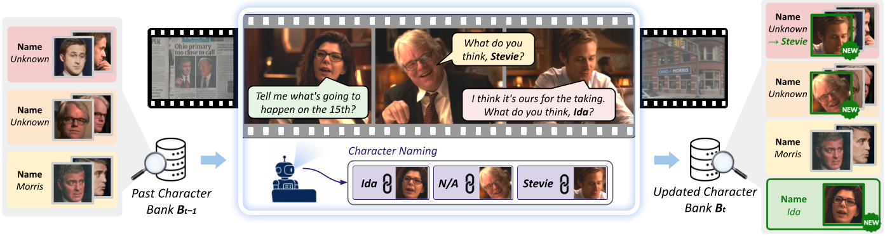

# Streaming Character Bank Construction

Builds a per-movie character bank online, one shot at a time. The pipeline
talks to three vLLM OpenAI-compatible endpoints (name linking, face
filtering, name filtering) plus a local GPU for tracking / clustering /
audio.

<p align="center">
  
</p>

Before launching, open [scripts/serve_agents.sh](scripts/serve_agents.sh)
and replace the `<MODEL_PATH>` placeholder in the `SERVICES` table with the
local path (fine-tuned checkpoints for Character Naming) or HF id for the `name_linking` model.

## Install

```bash
conda create -n char_bank python=3.10 -y
conda activate char_bank

# CUDA-enabled PyTorch (match your CUDA toolkit; example uses CUDA 12.1)
pip install torch torchaudio --index-url https://download.pytorch.org/whl/cu121

# vLLM serving runtime (used by scripts/serve_agents.sh)
pip install vllm

# Core pipeline deps
pip install numpy requests tqdm opencv-python metaphone

# Speech / diarisation
pip install speechbrain
pip install git+https://github.com/BUTSpeechFIT/DiariZen.git

# spaCy + transformer NER models (English / Chinese)
pip install "spacy[transformers]"
python -m spacy download en_core_web_trf
python -m spacy download zh_core_web_trf

# System dependency (used for audio/video extraction via subprocess)
conda install -c conda-forge ffmpeg -y
```

## Single 4-GPU node (recommended)

[scripts/run_all.sh](scripts/run_all.sh) launches the three agents on GPUs
0/1/2, waits until each `/v1/models` endpoint answers, then runs
`run_pipeline.py` on GPU 3. Agents are torn down automatically when the
pipeline exits.

```bash
scripts/run_all.sh \
  --imdbid tt0330373 \
  --shot_seg_file  /path/to/meta/shot_metadata.json \
  --track_file     /path/to/track_file/person_tracks_with_feats.pkl \
  --transcript_dir /path/to/transcripts/parakeet \
  --video_dir      /path/to/video \
  --score_dir      /path/to/person_tracks/asd \
  --output_dir     /path/to/output \
  --verbose
```

The six path flags are required. See
[preprocessing/README.md](../preprocessing/README.md) for how the inputs are
made. Pass `--score_dir ""` to skip sync scoring.

Any extra arguments are forwarded to [run_pipeline.py](run_pipeline.py).
Overrides:

- `PIPELINE_GPU` — GPU index for the pipeline (default `3`).
- `LOG_DIR` — where `serve_agents.sh` writes per-service logs.
- `READY_TIMEOUT` — per-endpoint readiness timeout in seconds (default `1800`).

## Split hosts on more than one node

Start the agents on a host with 3 GPUs:

```bash
bash scripts/serve_agents.sh
```

Run the pipeline anywhere with one GPU and network access to the agent
host:

```bash
python run_pipeline.py \
  --imdbid tt0330373 \
  --shot_seg_file  /path/to/meta/shot_metadata.json \
  --track_file     /path/to/track_file/person_tracks_with_feats.pkl \
  --transcript_dir /path/to/transcripts/parakeet \
  --video_dir      /path/to/video \
  --score_dir      /path/to/person_tracks/asd \
  --output_dir     /path/to/output \
  --base_vlm_url   "http://<host>:8001/v1" \
  --vlm_linker_url "http://<host>:8000/v1" \
  --llm_url        "http://<host>:8002/v1"
```

Port-to-service mapping (from `scripts/serve_agents.sh`):

| Port | Service          | `run_pipeline.py` flag |
| ---- | ---------------- | ---------------------- |
| 8000 | name linking     | `--vlm_linker_url`     |
| 8001 | face filtering   | `--base_vlm_url`       |
| 8002 | name filtering   | `--llm_url`            |

## Batch mode

Process a list of IMDb IDs, optionally sharded:

```bash
python run_pipeline.py \
  --imdbid_lst "/path/to/imdbid_list.json" \
  --shot_seg_file  /path/to/meta/shot_metadata.json \
  --track_file     /path/to/track_file/person_tracks_with_feats.pkl \
  --transcript_dir /path/to/transcripts/parakeet \
  --video_dir      /path/to/video \
  --score_dir      /path/to/person_tracks/asd \
  --output_dir     /path/to/output \
  --num_chunks 4 --chunk_idx 0
```

## Outputs

Per-movie artifacts land in `{output_dir}/{imdbid}/`:

- `character_bank.pkl` — final bank.
- `trajectory_log.pkl` — per-shot bank deltas.
- `summary.json` — `total_clusters`, `named_clusters`, `unresolved_cluster_ids`.
- `timeline/`, `bank_vis/`, `vlm_frames/` — optional visualisations.
