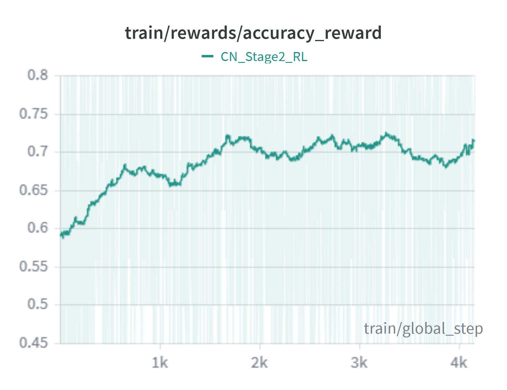

# Character Naming

We introduce a character naming (CN) task: given a name mentioned in dialogue, the model 
must identify which person appearing in the associated clip the name refers to. This 
formulation makes the task automatically generable and evaluable. To address it, we 
provide code for a two-stage R1-style fine-tuning recipe for a multimodal LLM. Stage 
I is a supervised cold start on synthetic reasoning traces, and Stage II applies GRPO 
with a composite format-plus-accuracy reward and color-permutation augmentation.

## Install Environment

We keep two conda environments, because Stage II needs a newer `transformers`
than Stage I and inference. The launch scripts activate them by name.

### `qwen`: Stage I and inference

We refer to the [Qwen3-VL fine-tuning requirements](https://github.com/QwenLM/Qwen3-VL/tree/main/qwen-vl-finetune)
for installing the conda environment. For transformers, we notice that ROPE
implementation in some transformers versions is erroneous. We recommend:

```bash
conda activate qwen
pip install transformers==4.57.0 qwen-vl-utils==0.0.14 insightface==0.7.3 onnxruntime-gpu
```

Stage I also imports the `qwenvl` package from
[Qwen3-VL](https://github.com/QwenLM/Qwen3-VL). It has no `setup.py`, so it
cannot be installed with `pip`. Put it on `PYTHONPATH` instead, in every shell
that launches Stage I:

```bash
git clone https://github.com/QwenLM/Qwen3-VL.git
git -C Qwen3-VL checkout e5c7e5c
export PYTHONPATH=$PWD/Qwen3-VL/qwen-vl-finetune:$PYTHONPATH
```

`qwenvl` reads its dataset list from its own folder, so register the Stage I
dataset in `Qwen3-VL/qwen-vl-finetune/qwenvl/data/__init__.py`:

```python
NAME_LINKING_DATASET_STAGE1_SFT = {
    "annotation_path": "<path/to/stage_1_sft_cold_start.json>",
    "data_path": "<path/to/dataset/root>",
}

data_dict = {
    # ... existing entries ...
    "name_linking_stage1": NAME_LINKING_DATASET_STAGE1_SFT,
}
```

### `video-r1`: Stage II

We refer to https://github.com/tulerfeng/Video-R1 for installing the conda
environment, then:

```bash
conda activate video-r1
pip install transformers==5.2.0 trl==0.28.0 accelerate==1.12.0 deepspeed==0.18.6 peft==0.18.1 qwen-vl-utils==0.0.14
```

Do not use `transformers==4.57.0` for Stage II. With `--num_generations` above
1, `generate()` raises on multi-frame video, and the trainer skips the sample
with zero loss instead of stopping.

## Stage I: Supervised Fine-tuning (cold start)

Supervises the MLLM with synthetic reasoning traces produced by a teacher MLLM
that is given the video frames, visually grounded subtitles, and ground-truth
name-to-color mapping. This teaches the student the desired
"reasoning trace to answer" output format before RL.

- Entry: [sft/train/train_qwen.py](sft/train/train_qwen.py)
- Launch script: [scripts/stage1_sft.sh](scripts/stage1_sft.sh)
- Base model: `Qwen/Qwen3-VL-4B-Thinking`
- Dataset key: `name_linking_stage1`, registered in `qwenvl` (see
  [Install Environment](#install-environment)).
- Tunes the LLM only (`--tune_mm_llm True`, vision and MLP frozen).

```bash
bash scripts/stage1_sft.sh
```

Set `run_name` and `output_dir` in the script before launching.

## Stage II: Reinforcement Learning (GRPO)

Applies GRPO with a composite reward `R = r_f + r_a`:

- `r_f` rewards adherence to the expected response structure.
- `r_a = Σ_n 1[î(n) = i*(n)]` counts correctly predicted name to face-track assignments.

A naive GRPO run lets the model latch onto color-specific cues (e.g. always
mapping the protagonist to "red" because it is the most common color in the
training distribution). We address this with **color-permutation
augmentation**: the color assignment is randomly permuted per sample at
training time. The ground-truth name → face mapping is invariant under such
permutations, so consistent rewards across permuted variants are only
achievable by reasoning about identity itself.

- Entry: [r1/grpo.py](r1/grpo.py)
- Trainer: [r1/trainer/grpo_trainer.py](r1/trainer/grpo_trainer.py),
  [r1/trainer/vllm_grpo_trainer.py](r1/trainer/vllm_grpo_trainer.py)
- Launch script: [scripts/stage2_r1.sh](scripts/stage2_r1.sh)
- Initial weights: Stage I checkpoint (set `--model_name_or_path`).
- Dataset: color-permuted JSON (e.g. `stage_2_gpro_rl_aug.json`).
- Videos: `--data_root` is the directory that the `path` values in the
  dataset JSON are relative to.

Set the paths at the top of the launch script, then run:

```bash
bash scripts/stage2_r1.sh
```




Useful flags exposed in [r1/grpo.py](r1/grpo.py):

- `--len_control` — enable the length-control reward shaping.
- `--temporal` — temporal GRPO, on unless set to `false`; the launch script
  sets it to `false`.
- `--reward_funcs` — list of reward functions to combine (default
  `accuracy format`).

## Inference

[inference.py](inference.py) is a single entry point for both the
thinking and instruct variants of Qwen3-VL. The `--thinking` flag
(default `True`, disable with `--no-thinking`) controls:

- Whether to apply `AutoConfig.from_pretrained(args.model)` as a config
  override on the checkpoint.
- Whether to load the processor from the base model (`--model`) or the
  checkpoint (`--checkpoint`).
- Whether to strip the `<think> … </think>` prefix before JSON parsing.

Run these in the `qwen` environment.

Thinking model (default):

```bash
python inference.py \
    --model Qwen/Qwen3-VL-4B-Thinking \
    --checkpoint "<path/to/stage2/checkpoint>" \
    --csv_file "<test.csv>" \
    --video_dir "<path/to/video/root>" \
    --output_jsonl "<preds.jsonl>" \
    --max_new_tokens 4096 \
    --prompt_id 6
```

Instruct model:

```bash
python inference.py --no-thinking \
    --model Qwen/Qwen3-VL-8B-Instruct \
    --checkpoint "<path/to/checkpoint>" \
    --csv_file "<test.csv>" \
    --video_dir "<path/to/video/root>" \
    --output_jsonl "<preds.jsonl>" \
    --max_new_tokens 256 \
    --prompt_id 4
```

- `--prompt_id` selects the template in [promptloader.py](promptloader.py).
  Use `6` for the thinking model and `4` for the instruct model. The default
  is `4`, so set it for the thinking model.
- `--video_dir` is the directory that the `video_path` values in the CSV are
  relative to.
- Omit `--checkpoint` to run the base model.

Output is JSONL with one record per video: `index`, `video_path`,
`response_text`, and the parsed `response_json`.

## Ablation

[scripts/ablation_ft.sh](scripts/ablation_ft.sh) runs plain supervised
fine-tuning of `Qwen/Qwen3-VL-8B-Instruct` on the `name_linking_ft` dataset
(LLM + MM projector tuned, vision frozen) as a baseline against the full
two-stage SFT + GRPO recipe.

It uses the same `qwen` setup as Stage I, with `name_linking_ft` registered in
`qwenvl` the same way as `name_linking_stage1` (see
[Install Environment](#install-environment)). Set `run_name` and `output_dir`
in the script before launching.

```bash
bash scripts/ablation_ft.sh
```
